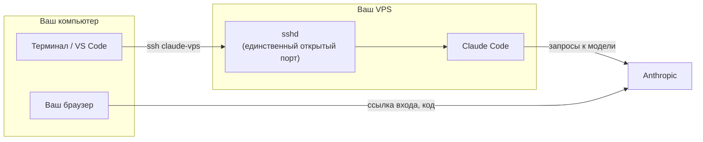

# Claude Code на своём VPS — одной командой и без рабочего стола на сервере

[](https://t.me/Undercode_ai)
[](https://www.youtube.com/@undercode_ai)
[](https://www.instagram.com/undercode_ai)

Скрипт превращает чистый VPS на Debian или Ubuntu в рабочее место для Claude Code:
ставит Claude Code, создаёт отдельного пользователя, настраивает вход по ключу и
защиту сервера, добавляет готовое подключение для VS Code и терминала. В конце вы
входите в свой аккаунт Claude штатным способом Claude Code: ссылка и код.

На сервер **не ставится** ни рабочий стол, ни VNC, ни браузер. Вы работаете по SSH из
своего терминала или VS Code, а сайты с сервера открываете через проброс порта.

- Сервер: Debian 11, 12, 13 или Ubuntu 20.04, 22.04, 24.04, 26.04 (x86_64 или ARM64).
- Ваш компьютер: Windows 10/11, macOS или Linux.
- Подробная пошаговая инструкция и решение проблем: [docs/GUIDE.md](docs/GUIDE.md).

## Быстрый старт

Команду запускайте **на своём компьютере**, а не на сервере. Понадобятся IP-адрес
сервера и пароль root из панели хостинга.

**Windows** — откройте PowerShell (Пуск → PowerShell) и выполните:

```powershell
irm https://raw.githubusercontent.com/Djam36/claude-code-vps/main/install.ps1 | iex
```

**macOS или Linux** — откройте Терминал и выполните:

```bash
curl -fsSL https://raw.githubusercontent.com/Djam36/claude-code-vps/main/install.sh | bash
```

Дальше скрипт спросит IP сервера, SSH-порт (обычно просто Enter) и один раз пароль
root. Всё остальное он сделает сам за 3–7 минут и в конце предложит сразу войти в
Claude Code.

## Как это работает

Скрипт запускается на вашем компьютере и настраивает сервер по SSH. Сначала он один
раз входит по паролю root и кладёт на сервер отдельный ключ, дальше работает только по
ключу. В конце в `~/.ssh/config` появляется подключение `claude-vps`, а на компьютере —
команда `claude-vps` для повседневной работы.



**Вход в Claude Code** — штатный, как описано в
[документации Anthropic](https://code.claude.com/docs/en/authentication):

1. `claude-vps login` запускает на сервере `claude auth login`.
2. Claude Code показывает ссылку. Вы открываете её в обычном браузере на своём
   компьютере, входите в аккаунт Claude и нажимаете Authorize.
3. Страница показывает код. Вы вставляете его в терминал в строку
   `Paste code here if prompted`. Код нужен, потому что браузер на вашем компьютере не
   может сам вернуть ответ в Claude Code на сервере.
4. Токен хранится на сервере (`~/.claude/.credentials.json`), повторный вход нужен редко.

То же самое можно сделать без скрипта: `ssh claude-vps`, затем `claude`.

Сайт, который Claude запустил на сервере (например `npm run dev` на порту 3000),
открывается **пробросом порта** `ssh -L`: `claude-vps open 3000` или вкладка
Ports в VS Code. Порт сайта наружу не открывается.

Ручные команды, которые делают то же самое без скрипта, есть в
[docs/GUIDE.md](docs/GUIDE.md#как-сделать-то-же-самое-руками).

## Что делает установщик

| Шаг | Где | Что происходит |
|---|---|---|
| 1 | компьютер | Создаёт отдельный ключ `~/.ssh/claude_vps_ed25519` и один раз по паролю root кладёт его на сервер |
| 2 | компьютер | Берёт `bootstrap.sh` (из папки рядом или с GitHub) и проверяет версию |
| 3 | сервер | Проверяет систему и ресурсы, при RAM < 4 ГБ добавляет swap 2 ГБ, ставит `git`, `tmux`, `curl`, `ufw`, `fail2ban`; подключает **официальный подписанный apt-репозиторий Anthropic** (отпечаток ключа сверяется) и ставит Claude Code; создаёт пользователя `dev` с вашим ключом и паролем для `sudo` |
| 4 | компьютер | Проверяет вход под `dev` по ключу. Пока проверка не прошла, root и пароли **не** отключаются |
| 5 | сервер | Отключает вход root и вход по паролю, включает UFW (открыт только SSH), fail2ban и автообновления, в том числе Claude Code |
| — | компьютер | Добавляет в `~/.ssh/config` подключение `claude-vps` и ставит команду `claude-vps` |

Повторный запуск безопасен: скрипт продолжит с того места, где остановился, и ничего не
сломает на уже настроенном сервере.

## Ежедневная работа

| Задача | Команда |
|---|---|
| Войти в Claude Code (первый раз или после выхода) | `claude-vps login` |
| Терминал на сервере | `ssh claude-vps` |
| VS Code | Remote-SSH → Connect to Host → `claude-vps` |
| Сессия, которая переживёт обрыв связи | `claude-vps attach` (tmux; отсоединиться: Ctrl+B, затем D) |
| Открыть сайт, запущенный на сервере | `claude-vps open 3000` |
| Перенастроить сервер | `claude-vps setup` |

Проекты лежат на сервере в `/home/dev/work`. Внутри: `cd ~/work/мой-проект && claude`.

## Безопасность

- Вход на сервер только по ключу; root по SSH не пускается.
- Снаружи открыт только порт SSH (UFW), перебор паролей блокирует fail2ban.
- Обновления безопасности и обновления Claude Code ставятся автоматически.
- `sudo` у пользователя `dev` спрашивает пароль. Пароль скрипт сохраняет у вас:
  `~/.claude-vps/sudo-password-claude-vps.txt`. Агент не сможет сам выполнить
  `sudo` без вас — это сделано намеренно.
- Если нужен `sudo` без пароля, запустите установку с `CCV_SUDO=nopasswd`
  (см. ниже). Тогда любая команда агента сможет менять весь сервер.
- Приватный ключ `~/.ssh/claude_vps_ed25519` никому не отправляйте и не кладите в проекты.

## Настройки

Переменные окружения перед запуском (все необязательные):

| Переменная | По умолчанию | Что задаёт |
|---|---|---|
| `CCV_HOST` | спросит | IP или домен сервера |
| `CCV_PORT` | спросит, 22 | SSH-порт |
| `CCV_ADMIN_USER` | `root` | Пользователь для первого входа (например `ubuntu` с `sudo` без пароля) |
| `CCV_USER` | `dev` | Рабочий пользователь на сервере |
| `CCV_SUDO` | `password` | `password` или `nopasswd` |
| `CCV_ALIAS` | `claude-vps` | Имя подключения в `~/.ssh/config`. Запоминается в `~/.claude-vps/alias`, команде `claude-vps` его потом указывать не нужно |

Пример для macOS/Linux: `curl -fsSL …/install.sh | CCV_SUDO=nopasswd bash`.
Для PowerShell: `$env:CCV_SUDO = 'nopasswd'; irm …/install.ps1 | iex`.

## Удаление

На компьютере: удалите блок `# >>> claude-code-vps` из `~/.ssh/config`, папку
`~/.claude-vps`, файлы `~/.ssh/claude_vps_ed25519*` и команду `claude-vps`
(`~/.local/bin/claude-vps` или `%USERPROFILE%\.claude-vps`). Сервер проще всего
переустановить из панели хостинга. Подробнее — в [docs/GUIDE.md](docs/GUIDE.md#удаление).

## Автор

Делаю практические разборы про ИИ-агентов, DevOps и автоматизацию:

- Telegram: https://t.me/Undercode_ai
- YouTube: https://www.youtube.com/@undercode_ai
- Instagram: https://www.instagram.com/undercode_ai

## Лицензия

[MIT](LICENSE)
